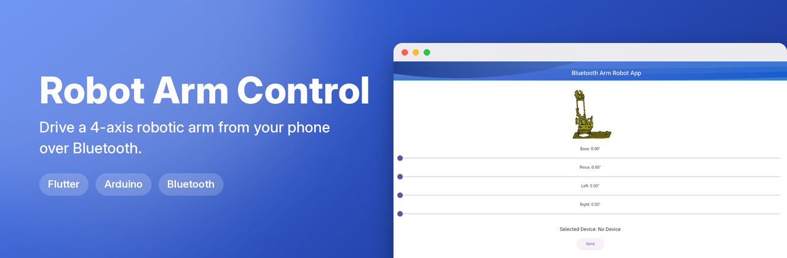
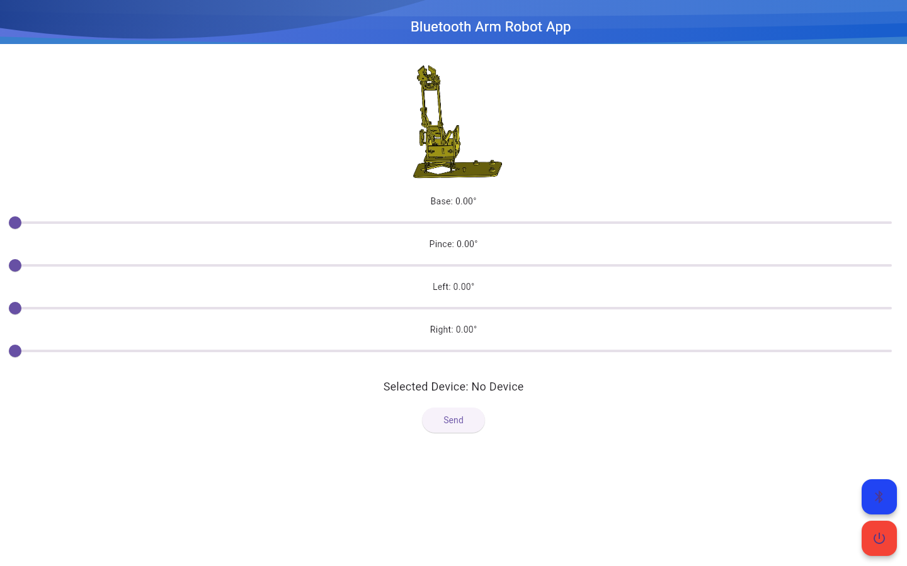
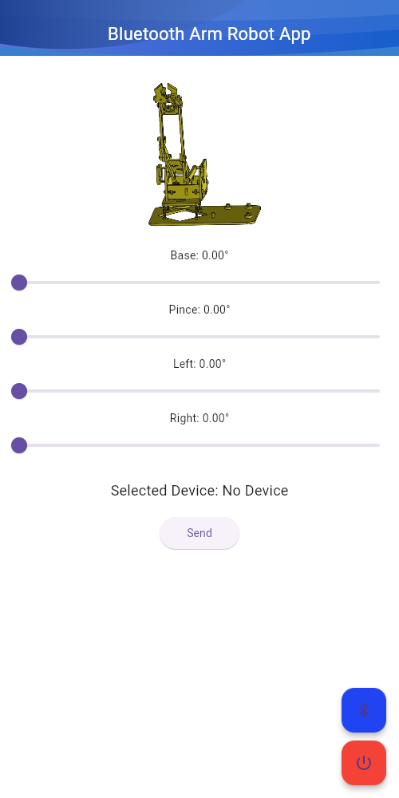

**▶ Live demo: [mohamedbenhmida-robotarm.web.app](https://mohamedbenhmida-robotarm.web.app)**

> The web demo shows the interface only: Bluetooth / device control needs the Android app and the hardware.

  
  

🤖 Bluetooth Robot Arm Control App

This project includes a Flutter mobile application and an Arduino sketch to control a robotic arm via Bluetooth. The Flutter app provides an intuitive interface to move and control various axes (Base, Pince, Left, Right) of the robotic arm.

🚀 Features
	•	Flutter App:
	•	Scan and connect to Bluetooth devices.
	•	Send commands to control the robot arm’s joints:
	•	Base: Controls the rotation of the arm.
	•	Pince: Opens and closes the gripper.
	•	Left and Right: Adjust the arm’s position.
	•	Display connected device information.
	•	User-friendly sliders for smooth control.
	•	Send button and disconnect functionality.
	•	Arduino Code:
	•	Receives commands via Bluetooth.
	•	Parses and executes movements for the robotic arm.
	•	Servo motor control for precise movements.

 
🛠️ Requirements

Hardware:
	•	Robotic Arm (servo-based mechanism).
	•	Arduino Board (e.g., Uno, Mega, etc.).
	•	HC-05/HC-06 Bluetooth Module.
	•	Servo Motors connected to the robotic arm.

Software:
	•	Flutter: For developing the mobile app.
	•	Arduino IDE: To upload the control code to the Arduino.

💻 Setup Instructions

1. Flutter App
	1.	Install Flutter SDK: Flutter Installation Guide
	2.	Clone the repository:

git clone https://github.com/mohamedbnhmida/RobotArmControl.git
cd flutter

	3.	Install dependencies:

flutter pub get

	4.	Connect your Android device or emulator and run the app:

flutter run

2. Arduino Code
	1.	Connect the Bluetooth module (HC-05) and servo motors to your Arduino board:
	•	TX/RX Pins for Bluetooth communication.
	•	PWM pins for servo motor control.
	2.	Open the Arduino IDE and upload the provided Arduino sketch (robot_arm_control.ino).
	3.	Pair your Bluetooth module with your mobile device.

📡 How It Works
	1.	The Flutter app scans for available Bluetooth devices.
	2.	Once connected, the app sends servo position values over Bluetooth.
	3.	The Arduino receives the commands and adjusts the servo motors accordingly:
	•	Commands are formatted as strings (e.g., BASE:45).

🔧 Customizing the App
	•	Modify the servo pin definitions in the Arduino sketch.
	•	Update UI components or add new features in Flutter (e.g., predefined positions).

🤝 Contributing

Contributions are welcome! If you want to improve the app or add functionality:
	1.	Fork the repository.
	2.	Create a new branch:

git checkout -b feature-new-feature

	3.	Commit your changes:

git commit -m "Add new feature"

	4.	Push to your branch and create a pull request.

📜 License

This project is licensed under the MIT License.

🎉 Acknowledgements
	•	Built with Flutter for cross-platform UI development.
	•	Powered by Arduino for robotics control.

👨‍💻 Developed By
	•	Ben Hmida Mohamed
	•	Contact: mohamed.benhmida@isimg.tn
 